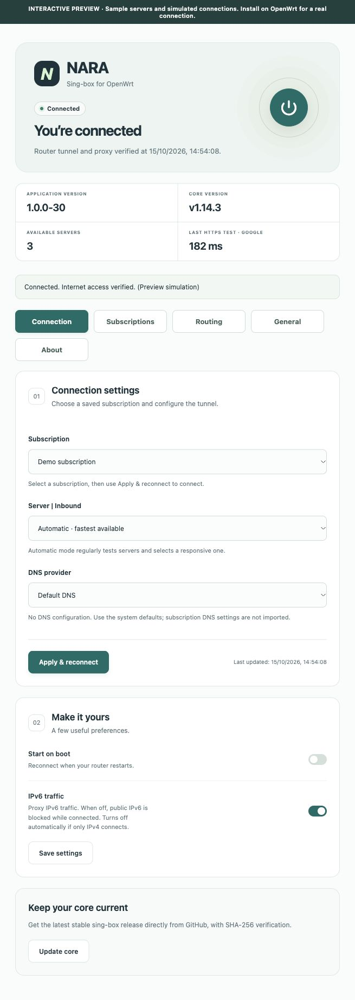

# NARA

**Sing-box for OpenWrt**

An English LuCI application for managing sing-box subscriptions, connecting your router and LAN devices through a TUN, and choosing which destinations use a direct connection.

Created by **Kevin Zakarian**. Current application version: **1.0.0-30**.



*Full-page Connection tab, using the Default skin and simulated preview data.*

## Features

- Save multiple HTTP/HTTPS subscriptions. Adding a subscription downloads and validates it without changing the active connection.
- Import sing-box JSON or V2Ray URI/Base64 subscriptions: VLESS, VMess, Trojan, Shadowsocks, Hysteria2, TUIC and AnyTLS.
- Select a server manually or use automatic URL testing.
- Download the latest stable official sing-box core for the router's architecture and verify its release SHA-256 digest. The core is not bundled.
- Choose Default DNS, Cloudflare, Google, OpenDNS or Custom DNS.
- Route country IPs and domains directly using independent Iran, China or Russia lists.
- Save custom Direct and VPN exceptions, one IP/CIDR or domain per line.
- Update and test subscriptions individually or in bulk, with Ping, TCPing and HTTPS URL Test results.
- Switch between Default and Orange skins and optionally connect on boot.
- Validate before activation and attempt to restore the previous connection if startup or Internet verification fails.

## Requirements

Tested on **OpenWrt 24.10.6 x86_64**, with LuCI and firewall4/nftables. The supplied IPK targets **OpenWrt 24.10 with opkg**. Its interface and backend are architecture independent; a compatible official sing-box binary must exist for the router's CPU. Other architectures have not received the same hardware testing.

Dependencies include Python 3, curl, CA certificates, TUN/NFT kernel modules, ip-full and conntrack. Kernel packages must match the installed OpenWrt release. Plan for approximately **256 MB free persistent storage**, **64 MB temporary storage**, and **256 MB RAM or more**. These are planning estimates, not measured minimums. Small-flash routers generally require external storage.

Initial installation and updates need ordinary Internet access to OpenWrt package feeds, GitHub and the subscription provider. Set the router clock correctly. Stop other transparent proxy managers before connecting NARA.

## Install

Download the IPK and checksum from [Release 1.0.0-30](https://github.com/kevinzakarian/Nara/releases/tag/v1.0.0-30), or build the package locally as described below.

In LuCI, open **System → Software**, update package lists and upload `luci-app-nava_1.0.0-30_all.ipk`. Alternatively, copy it from your computer to your router. This example uses `192.168.50.1`; substitute your router's address if different:

```sh
scp -O dist/luci-app-nava_1.0.0-30_all.ipk root@192.168.50.1:/tmp/
ssh root@192.168.50.1 'opkg update && opkg install /tmp/luci-app-nava_1.0.0-30_all.ipk'
```

Reload LuCI and open **Services → NARA**. Package/service names remain `luci-app-nava` and `nava` for upgrade compatibility.

1. Open **Subscriptions → New subscription**, enter a name and URL, then save.
2. In **Connection**, select the subscription and **Server | Inbound**.
3. Select a DNS option and click **Apply & reconnect**. The first connection also installs the core.
4. Use the power button to disconnect. **Update** and **Update all subscriptions** refresh server lists; reconnect to apply changes to the running connection.

HTTP subscription content is unencrypted in transit. Conversion happens on the router; NARA does not send your URL to a conversion service.

For Persian instructions, see [INSTALL.fa.md](INSTALL.fa.md).

## DNS behavior

**Default DNS** generates no sing-box DNS section, resolver, listener or DNS hijack rule. It does not import subscription DNS settings or change WAN/dnsmasq upstream settings. Automatic TUN DNS hijacking is disabled in this mode; the TUN itself remains active.

Other options configure the chosen resolver through the proxy and temporarily forward router DNS to NARA while connected. **Custom DNS** accepts comma-separated IPs, hostnames, or `udp://`, `tcp://`, `tls://`, `https://` and `quic://` URLs. Examples: `9.9.9.9` and `94.140.14.14`. No Cloudflare resolver is added automatically. Disconnecting restores previous forwarding settings.

VPN hostname endpoints are resolved before switching connections to avoid a bootstrap loop. This can require the router's existing resolver. A browser's own encrypted DNS can affect DNS leak-test results. Resolver identity alone does not prove how website traffic is routed.

## Routing

Choose IP and domain lists independently, update them, enable country routing and click **Apply routing**. Matching Internet destinations use Direct; other destinations use the VPN.

| Country | List source |
| --- | --- |
| Iran | [Chocolate4U/Iran-sing-box-rules](https://github.com/Chocolate4U/Iran-sing-box-rules) |
| China | [Loyalsoldier/geoip](https://github.com/Loyalsoldier/geoip) and [Loyalsoldier/v2ray-rules-dat](https://github.com/Loyalsoldier/v2ray-rules-dat) |
| Russia | [runetfreedom/russia-v2ray-rules-dat](https://github.com/runetfreedom/russia-v2ray-rules-dat), geographic RU/category-ru lists |

Country bypass rules exclude ports 53 and 853 so those DNS connections keep the normal VPN route. Lists are downloaded and validated before replacing the saved generation. Community classifications may not cover every destination.

**Custom routing** provides four saved multiline boxes:

| Box | Meaning |
| --- | --- |
| Direct IP addresses | IPv4, IPv6 or CIDR destinations that bypass the VPN |
| Direct Domains | Domains and subdomains that bypass the VPN |
| VPN IP addresses | IPv4, IPv6 or CIDR destinations that use the VPN |
| VPN Domains | Domains and subdomains that use the VPN |

Enter one item per line, up to 256 unique entries and 8 KB per box. VPN exceptions take priority over custom Direct and country lists. Custom exceptions work while connected even if country routing is disabled. Existing local-network access, explicit DNS provider handling and IPv6 preferences retain their priority.

Domain matching requires a hostname visible to sing-box. Hidden/encrypted hostnames may only match by IP. These are traffic-routing rules, not per-domain DNS resolver rules.

While disconnected, **Apply routing only saves preferences** without changing the live network. While connected, it reconnects and verifies the configuration. Disconnecting restores ordinary routing: NARA is not a kill switch.

## Subscription tests

- **Ping:** ICMP response time from a proxy endpoint. Some working servers block ICMP.
- **TCPing:** TCP connection time to the server port. UDP protocols such as Hysteria2 and TUIC show N/A.
- **URL Test:** Time to obtain an HTTPS response through a proxy to the selected website. This measures latency and reachability, not bandwidth. **Restricted** means the website returned an access restriction such as HTTP 403 or 429.

Rows summarize the best result and successful-node count. The best result for each metric may belong to a different node. Large subscriptions take longer. Separate connection verification uses Google's `https://www.gstatic.com/generate_204`, independently of the subscription test target.

## Compatibility

Native JSON supports SOCKS and HTTP leaf outbounds in addition to the protocols above. Selectors and automatic groups are rebuilt locally. Supported transports depend on the protocol and include TCP, WebSocket, gRPC, HTTP/2 and HTTPUpgrade.

Clash YAML, SIP008, legacy VMess URI variants, XHTTP/KCP, executable Shadowsocks plugins, WireGuard endpoints, chained native outbounds and configurations requiring external local files are not supported. Provider DNS/routing rules are not imported as a complete configuration. Unsupported entries produce warnings; valid credentials and a working remote server are still required.

Public IPv6 is blocked while IPv6 traffic is disabled; local networks remain accessible. Verification runs during activation and does not guarantee continuous Internet availability or cover every LAN client.

## Build and test

Use **Python 3.12 or newer** for development and packaging. No SDK or third-party Python libraries are required for the standalone IPK builder:

```sh
python3 scripts/build.py
python3 -m unittest discover -s tests
```

Output: `dist/luci-app-nava_1.0.0-30_all.ipk` and `dist/SHA256SUMS`. Verify before installing:

```sh
cd dist
shasum -a 256 -c SHA256SUMS
# Linux: sha256sum -c SHA256SUMS
```

For real-core configuration and loopback tests, provide an official sing-box binary compatible with your development computer (validated with **1.14.3**):

```sh
SING_BOX_TEST_BINARY=/absolute/path/to/sing-box python3 -m unittest discover -s tests
```

Without that variable, real-core tests are skipped. Integration tests use local sockets without creating a host TUN or changing the computer's routes. Coverage includes parsing, DNS changes, bootstrap, routing precedence, offline saves, rollback and package extraction/upgrades. Historical regression filenames remain to preserve coverage.

With an OpenWrt SDK containing the LuCI feed, copy `luci-app-nava/` into `package/` and build `package/luci-app-nava/compile`.

### Local interface preview

```sh
python3 -m http.server 8765 --bind 127.0.0.1
```

Open `http://127.0.0.1:8765/preview/`. The production LuCI view runs with simulated responses, without connecting a VPN or changing routing.

## Troubleshooting and privacy

Check the operation message, selected server and core version. Include application/core versions and reproduction steps when opening an issue. Scripts in `scripts/` produce redacted DNS/routing reports; review output before sharing. Never publish subscription URLs, passwords, private keys, router backups or unredacted logs.

Local `snapshots/`, build output and historical router diagnostics are excluded from Git. Packaged default settings contain no subscriptions or credentials.

## License and upstream

NARA is an independent project under the [MIT license](LICENSE), not an official SagerNet product. sing-box is downloaded separately and remains subject to its own license. Routing lists are fetched at runtime and retain their respective upstream licenses.

- [sing-box documentation](https://sing-box.sagernet.org/)
- [sing-box source](https://github.com/SagerNet/sing-box)
